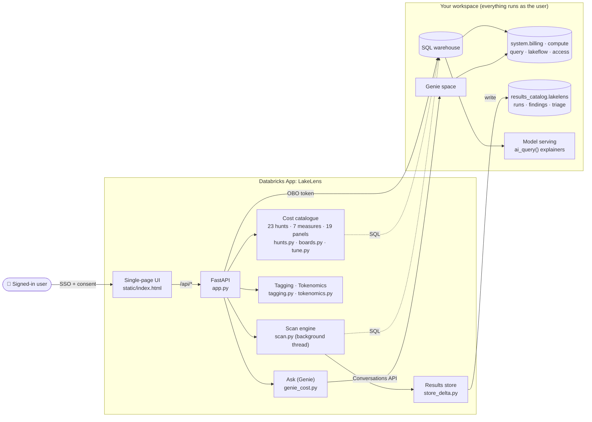

# LakeLens: FinOps for the Lakehouse

**See every dollar. Spot every saving.**

LakeLens is a Databricks App that runs a plain-English cost review of your workspace. It reads only your own `system.*` tables, runs every query as the signed-in user, and never changes a setting. The one exception is tagging, which only writes when you confirm it.

- **23 cost hunts** find waste across AI, idle compute, heavy reads, long-running work, config and spend trends
- **One-click scan** turns the results into a triaged alert queue with severity, explanation, fix and proof
- **4 observability boards** (19 panels) flag anomalies above each chart
- **7 measures** prove the saving before and after a fix
- **Ask** tab: a Genie space over your cost tables that shows the SQL behind every answer

Deploys in two commands as a Databricks Asset Bundle. Nothing workspace-specific is hardcoded.



---

## What's inside

| Tab | What it does |
|---|---|
| 🚨 **Alerts** | **Run full cost scan** runs every hunt in the background and builds an alert queue: severity, plain-English explanation, recommended fix, and the measure that proves it. Work it as *acknowledge → in progress → resolve / dismiss*. Results are saved to Delta and shared. Each run is compared with the last (NEW / WORSE / BETTER / FLAT). It also shows what the scan itself cost, and exports to PDF. |
| 📊 **Observability** | **Usage** (trend, SKU, workspace, AI forecast), **Jobs** (savings, low CPU, high memory, fixed workers, old DBR), **DBSQL** (by user, source, query, trend), **Model Serving** (batch, pay-per-token, provisioned, by endpoint). |
| ① **Spot** | The 23 hunts, grouped into 6 categories. Each card has a short summary, live results, an ✨ Explain button and PDF export. |
| ② **Tune** | 12 best-practice cards: job vs all-purpose compute, serverless, Photon, liquid clustering / PO / zstd, timeouts, policies, spot, AI guardrails, tagging, budgets. |
| ③ **Prove** | 7 measures that show the saving (see below). |
| 🏷️ **Tagging** | Finds untagged warehouses, clusters and spend. You can set a tag in place (confirmed, runs as you). |
| 💠 **Tokenomics** | Estimates AI cost before the bill: tokens → DBU → $, model comparison, live `list_prices` check, actual 30-day serving spend. |
| 💬 **Ask** | Natural-language cost questions through Genie. A one-time button creates the space. |

### The 23 hunts

| Category | Hunts |
|---|---|
| 🤖 AI & Model Serving | H0 Runaway AI spend |
| 💤 Idle Compute | H3 Chatter keeps warehouses awake · H4 Warehouses that never sleep · H14 Idle cores · H16 Jobs on all-purpose compute · H18 Idle interactive clusters · H19 Always-on Databricks Apps |
| 📖 Heavy Reads & Spill | H1 Read amplification · H2 Disk spill · H6 The scan paid five times · H21 Tables still on snappy (not zstd) |
| ⏱️ Long-Running & Repetitive | H5 Runaway statements (over 4 hours) · H7 Polling every 20 seconds |
| ⚙️ Right-Sizing & Config | H8 Queue pressure vs capacity · H9 Warehouse config audit · H17 Auto-stop disabled · H22 Serverless jobs in performance-optimised mode |
| 📈 Spend Trends & Attribution | H10 Spend by product (SKU) · H11 Jobs: weekly movers · H12 Jobs: who got slower? · H13 Cost per pipeline · H20 Frequently failing jobs · H23 Predictive Optimisation cost drivers |

H15 is left out on purpose. It's the only hunt that reads customer data, and LakeLens reads system tables only.

### The 7 measures (Prove)

M1 Per-query cost on shared warehouses · M1b Warehouse idle cost · M2 Exact $ per job and pipeline · M3 "After" scoreboard (weekly $ per warehouse) · M4 Benchmark a fix week over week · M5 Timeout guardrail scoreboard · M6 Serverless job cost by performance mode

---

## Deploy in your workspace

**You need:**
- Databricks CLI **0.246.0 or later** (`databricks --version`)
- A SQL warehouse (serverless is best). This is `warehouse_id`.
- A catalog you can `CREATE` in, to save scans. This is `results_catalog`. It's optional: without it, scans aren't saved.
- Permission to create Databricks Apps

```bash
databricks auth login --host https://<your-workspace>.cloud.databricks.com

# 1. Deploy (uploads the app, wires the warehouse + catalog, sets the OBO scopes)
databricks bundle deploy -t prod -p <profile> \
  --var="warehouse_id=<your-sql-warehouse-id>" \
  --var="results_catalog=<a-catalog-you-can-write-to>"

# 2. Start the app (prints the URL)
databricks bundle run lakelens -t prod -p <profile>
```

Tip: pin `host`, `warehouse_id` and `results_catalog` in the `prod` target of `databricks.yml` and skip the `--var`s.

### First run
1. Open the app URL and **Accept** the consent screen (SQL + Genie scopes).
2. Optional: add `/api/whoami` to the URL. You should see `"sql_ok": true` and your email.
3. **Alerts → Run full cost scan.**
4. **Ask → Create cost Genie space** (once).

### Settings

| Variable | Required | Default | What it is |
|---|---|---|---|
| `warehouse_id` | yes | none | SQL warehouse every query runs on |
| `results_catalog` | recommended | none | Where scans, triage and the Genie space id are saved |
| `results_schema` | no | `lakelens` | Schema inside that catalog |
| `ai_endpoint` | no | `databricks-gpt-5-4-mini` | Model for the plain-English explanations |
| `ai_endpoint_dbu` | no | `7.5,30` | That model's DBU per 1M tokens (in,out), used to price the scan |

### What users need
Every query runs as the signed-in user (on-behalf-of-user), so there are no service-principal grants. Each user needs:
- `SELECT` on `system.billing`, `system.compute`, `system.query`, `system.lakeflow`, `system.access`
- `CAN USE` on the SQL warehouse
- `CREATE` on `results_catalog` (for saving scans)
- Permission to create a Genie space (for the Ask tab's first run)

---

## Troubleshooting

| Symptom | Fix |
|---|---|
| Scans return an auth error | User lacks `SELECT` on a `system.*` schema or `CAN USE` on the warehouse. Check `/api/whoami`. |
| "No warehouse configured" | Redeploy with `--var="warehouse_id=..."`. |
| Scans don't save or aren't shared | `results_catalog` unset, or the user can't `CREATE` there. The app still works in memory. |
| Ask: "token does not have required scopes: genie" | Old consent. See *Changing scopes* below. |
| `bundle deploy` rejects `user_api_scopes` | Upgrade the CLI to 0.246.0 or later. |

<details>
<summary><b>Changing scopes after first deploy</b></summary>

Adding a scope to an app that users already authorised doesn't update their consent. Their token keeps the old scopes, even after clearing cookies. An admin can reset it:

```bash
CLIENT_ID=$(databricks apps get lakelens -p <profile> | jq -r .oauth2_app_client_id)
databricks api delete "/api/2.0/oauth-app-integrations/$CLIENT_ID/user-consent/me" -p <profile>
```

Then reopen the app in an incognito window and accept again. This bundle sets all scopes at first deploy, so you shouldn't need this.
</details>

<details>
<summary><b>How it works (architecture)</b></summary>

- **FastAPI** backend (`app/app.py`) and a single `static/index.html` with vendored Chart.js. No build step.
- **Scans run in the background** (`app/scan.py`). `POST /api/scan/start` returns a scan id at once. The browser polls and streams findings in, so no request comes near the ~120s app limit. Severity is rule-based (`hunts.ALERT_SPECS`); the AI only writes the explanation.
- **Saved to Delta** (`app/store_delta.py`): runs, findings and triage are saved in `results_catalog.results_schema`. The run row is written last, so readers never see a half-written run. If the schema isn't writable, the app falls back to memory.
- **Multi-worker safe:** scan ids are UUIDs, and polls fall back to `/api/scan/latest` if they hit a different worker.
- **Row cap:** only the top ~200 rows go to the browser, with the true total shown.
- **✨ Explain** uses `ai_query()`, which runs in the SQL engine with the rows inline and needs no extra scope.
- **Ask** creates a Genie space seeded with the billing, compute, query and lakeflow system tables. It saves the space id to Delta and chats through the Conversations API as the user.
- The hunt and measure SQL comes from a live-validated `weekly-cost-hunt` notebook.
</details>

<details>
<summary><b>Local development and SQL validation</b></summary>

```bash
cd app
export DATABRICKS_CONFIG_PROFILE=<profile>
export DATABRICKS_WAREHOUSE_ID=<warehouse_id>
export RESULTS_CATALOG=<catalog>
python3 -m uvicorn app:app --host 127.0.0.1 --port 8771
```

Locally, queries run as your CLI profile (no per-user OBO).

After editing any SQL, run `python3 validate.py` (every hunt, explainer and measure) and `python3 validate_boards.py` (every Observability panel). Both fail loudly on errors. Set the `PROFILE` / `WAREHOUSE` constants at the top first.
</details>
