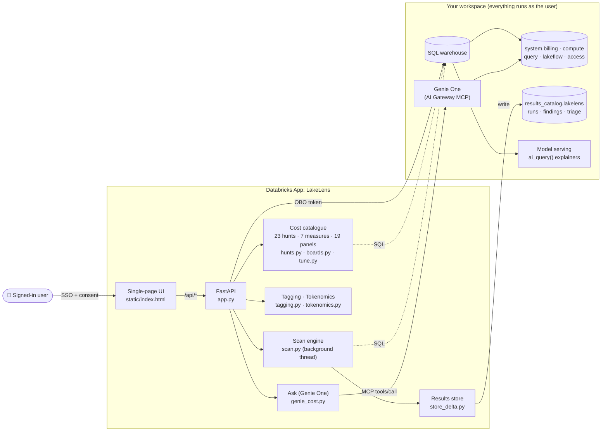

# LakeLens: FinOps for the Lakehouse

**See every dollar. Spot every saving.**

LakeLens is a Databricks App that runs a plain-English cost review of your workspace. It reads only your own `system.*` tables, runs every query as the signed-in user, and never changes a setting. The one exception is tagging, which only writes when you confirm it.

- **23 cost hunts** find waste across AI, idle compute, heavy reads, long-running work, config and spend trends
- **One-click scan** turns the results into a triaged alert queue with severity, explanation, fix and proof
- **4 observability boards** (19 panels) flag anomalies above each chart
- **7 measures** prove the saving before and after a fix
- **Ask** tab: Genie One answers cost questions and shows the SQL behind every answer

Deploys in two commands as a Databricks Asset Bundle. Nothing workspace-specific is hardcoded.



---

## What's inside

📖 **[Full catalogue](docs/CATALOGUE.md)**: every hunt, Tune practice and measure, with what it finds, how to read it, what to do, how it is graded and the system tables it reads.

🧮 **[Unit economics](docs/UNIT-ECONOMICS.md)**: cost per query, per active user and per TiB read, and the effective discount, from system tables only. Also a [Genie One skill](docs/skills/unit-economics/SKILL.md).

| Tab | What it does |
|---|---|
| 🚨 **Alerts** | **Run full cost scan** runs every hunt in the background and builds an alert queue: severity, plain-English explanation, recommended fix, and the measure that proves it. Work it as *acknowledge → in progress → resolve / dismiss*. Results are saved to Delta and shared. Each run is compared with the last (NEW / WORSE / BETTER / FLAT, or DEFINITION CHANGED when a hunt now measures something different, so the two numbers are not compared). It also shows what the scan itself cost, and exports to PDF. |
| 📊 **Observability** | **Usage** (trend, SKU, workspace, AI forecast), **Jobs** (savings, low CPU, high memory, fixed workers, old DBR), **DBSQL** (by user, source, query, trend), **Model Serving** (batch, pay-per-token, provisioned, by endpoint). |
| ① **Spot** | The 23 hunts, grouped into 6 categories. Each card has a short summary, live results, an ✨ Explain button and PDF export. |
| ② **Tune** | 12 best-practice cards: job vs all-purpose compute, serverless, Photon, liquid clustering / PO / zstd, timeouts, policies, spot, AI guardrails, tagging, budgets. [Details](docs/CATALOGUE.md#tune-practices). |
| ③ **Prove** | 7 measures that show the saving (see below). [Details](docs/CATALOGUE.md#measures). |
| 🏷️ **Tagging** | Finds untagged warehouses, clusters and spend. You can set a tag in place (confirmed, runs as you). |
| 💠 **Tokenomics** | Estimates AI cost before the bill: tokens → DBU → $ for every model this workspace serves, at Databricks' published rates and the list $/DBU of the SKUs this workspace bills on its own cloud, tier and region. Also the actual 30-day serving spend. |
| 💬 **Ask** | Natural-language cost questions through Genie One. No setup. Each answer shows its SQL, a result table and a link to open it in Genie One. |

### The 23 hunts

| Category | Hunts |
|---|---|
| 🤖 AI & Model Serving | H0 Runaway AI spend |
| 💤 Idle Compute | H3 Chatter keeps warehouses awake · H4 Warehouses that never sleep · H14 Idle cores · H16 Jobs on all-purpose compute · H18 Idle cores on interactive clusters · H19 Databricks Apps compute |
| 📖 Heavy Reads & Spill | H1 Read amplification · H2 Disk spill · H6 Unusually heavy scan hours across the account · H21 Tables still on snappy (not zstd) |
| ⏱️ Long-Running & Repetitive | H5 Statements far longer than the account's usual · H7 Repeated identical queries (polling) |
| ⚙️ Right-Sizing & Config | H8 Queue pressure vs capacity · H9 Warehouse config audit · H17 Auto-stop disabled · H22 Serverless jobs in performance-optimised mode |
| 📈 Spend Trends & Attribution | H10 Spend by product (SKU) · H11 Jobs: weekly movers · H12 Jobs: who got slower? · H13 Cost per pipeline · H20 Frequently failing jobs · H23 Predictive Optimisation cost drivers |

H15 is left out on purpose. It's the only hunt that reads customer data, and LakeLens reads system tables only.

Details for each hunt are in the [catalogue](docs/CATALOGUE.md#hunts).

### The 7 measures (Prove)

M1 Per-query cost on shared warehouses · M1b Warehouse idle cost · M2 Exact $ per job and pipeline · M3 "After" scoreboard (weekly $ per warehouse) · M4 Benchmark a fix week over week · M5 Timeout guardrail scoreboard · M6 Serverless job cost by performance mode

---

## Deploy in your workspace

**You need:**
- Databricks CLI **0.246.0 or later** (`databricks --version`)
- A SQL warehouse (serverless is best). This is `warehouse_id`.
- A catalog you can `CREATE` in, to save scans. This is `results_catalog`. It's optional: without it, scans aren't saved.
- Permission to create Databricks Apps

```bash
databricks auth login --host https://<your-workspace>.cloud.databricks.com

# 1. Deploy (uploads the app, wires the warehouse + catalog, sets the OBO scopes)
databricks bundle deploy -t prod -p <profile> \
  --var="warehouse_id=<your-sql-warehouse-id>" \
  --var="results_catalog=<a-catalog-you-can-write-to>"

# 2. Start the app (prints the URL)
databricks bundle run lakelens -t prod -p <profile>
```

Tip: pin `host`, `warehouse_id` and `results_catalog` in the `prod` target of `databricks.yml` and skip the `--var`s.

### First run
1. Open the app URL and **Accept** the consent screen (SQL, AI Gateway and Genie scopes).
2. Optional: add `/api/whoami` to the URL. You should see `"sql_ok": true` and your email.
3. **Alerts → Run full cost scan.**
4. **Ask:** pick a sample question. There's nothing to create first.

### Settings

| Variable | Required | Default | What it is |
|---|---|---|---|
| `warehouse_id` | yes | none | SQL warehouse every query runs on |
| `results_catalog` | recommended | none | Where scans and triage are saved |
| `results_schema` | no | `lakelens` | Schema inside that catalog |
| `ai_endpoint` | no | `databricks-gpt-6-luna` | Model for the plain-English explanations. A scan prices its AI cost at the published rate of the model it used, from `app/rate_card.json` |
| `anomaly_high_x` | no | `3` | An alert is high when it is at least this many times its own usual |
| `anomaly_medium_x` | no | `2` | An alert is medium when it is at least this many times its own usual |

### How alerts are graded
Each alert answers two questions for an admin: is the **account** behaving abnormally, and who caused it?

- **The account metric.** Each hunt computes one metric across everything the system tables show (every job, warehouse, person, client or table), for the last 7 days and for each of the four 7-day windows before it. Every window is a full 7 days counted back from now (complete days for billing data), so no window is a partial calendar week.
- **Its normal.** The account's normal is the median of those four prior windows. Totals (DBUs, hours, $, runs, statements) use the weekly total. Peaks (the busiest hour, the longest statement) use each window's peak. A quiet window counts as 0.
- **Severity.** `vs_normal` is this window's value over that normal. **High** at `anomaly_high_x` times (default 3), **medium** at `anomaly_medium_x` (default 2). Anything less raises no alert. **NEW**: when the account has no normal yet (the median of the four prior windows is 0), the alert is medium.
- **Who caused it.** The rows are the top contributors this window, largest first, each with `share_pct` of the account value. For a total the shares add up to the account value; for the busiest hour they split that hour; for the longest statement each row is a source's longest as a % of the account's.
- **Configuration hunts** (H17 auto-stop disabled, H21 likely-snappy tables) have no time series. Any row is medium.

No hunt hard-codes a size, duration or CPU cut-off: a "repeat" (H7) is any rerun of an identical SELECT by the same identity in the same clock hour, with no minimum count, and "idle" (H18) weights node-minutes by unused CPU. So the rule works the same in a small account and a large one. It catches change, not steady waste: an account that has run the same All-Purpose jobs every week for months reads about 1x its normal and raises no alert, though the hunt still lists them on the Spot tab. Each hunt's metric and normal are listed in the [catalogue](docs/CATALOGUE.md).

Saved scans show each hunt under its current title and fix, so a renamed hunt never reads under its old name. The headline and metric stay as that scan measured them.

### What users need
Every query runs as the signed-in user (on-behalf-of-user), so there are no service-principal grants. Each user needs:
- `SELECT` on `system.billing`, `system.compute`, `system.query`, `system.lakeflow`, `system.access`
- `CAN USE` on the SQL warehouse
- `CREATE` on `results_catalog` (for saving scans)
- `EXECUTE` on `system.ai.genie_one_mcp` for the Ask tab. This is usually granted to all account users.

The app needs the `ai-gateway` scope (set by this bundle), and the account needs Unity AI Gateway with Genie One available.

---

## Troubleshooting

| Symptom | Fix |
|---|---|
| Scans return an auth error | User lacks `SELECT` on a `system.*` schema or `CAN USE` on the warehouse. Check `/api/whoami`. |
| 503 "No warehouse configured" | Redeploy with `--var="warehouse_id=..."`. |
| 401 "No user token on this request" | The request didn't come through the app's Databricks URL, or consent wasn't accepted. Open the app from its URL. Deployed, the app never falls back to its own service principal. |
| 401 "Databricks rejected your sign-in token" | The session expired. Reload the app. |
| 502 "AI endpoint '...' is unavailable" | That model doesn't exist here or you can't query it. Pick another under **AI model**, or redeploy with `--var="ai_endpoint=..."`. |
| Scans don't save or aren't shared | `results_catalog` unset, or the user can't `CREATE` there. The app still works in memory. |
| Ask: "Genie One refused this user" | Old consent without `ai-gateway`, or no `EXECUTE` on `system.ai.genie_one_mcp`. See *Changing scopes* below. |
| Ask: "Genie One isn't available in this workspace" | The account doesn't have Unity AI Gateway or Genie One yet. Ask your account team. |
| Ask: "Genie took longer than 3 minutes" | Busy warehouse or a broad question. Open the Genie One link, or ask a narrower question. |
| `bundle deploy` rejects `user_api_scopes` | Upgrade the CLI to 0.246.0 or later. |

<details>
<summary><b>Changing scopes after first deploy</b></summary>

Adding a scope to an app that users already authorised doesn't update their consent. Their token keeps the old scopes, even after clearing cookies. An admin can reset it:

```bash
CLIENT_ID=$(databricks apps get lakelens -p <profile> | jq -r .oauth2_app_client_id)
databricks api delete "/api/2.0/oauth-app-integrations/$CLIENT_ID/user-consent/me" -p <profile>
```

Then reopen the app in an incognito window and accept again. This bundle sets all scopes at first deploy. Apps deployed before the `ai-gateway` scope was added need this reset once.
</details>

<details>
<summary><b>How it works (architecture)</b></summary>

- **FastAPI** backend (`app/app.py`) and a single `static/index.html` with vendored Chart.js. No build step.
- **Scans run in the background** (`app/scan.py`). `POST /api/scan/start` returns a scan id at once. The browser polls and streams findings in, so no request comes near the ~120s app limit. Severity is rule-based (`hunts.ALERT_SPECS`); the AI only writes the explanation. See *How alerts are graded*.
- **Saved to Delta** (`app/store_delta.py`): runs, findings and triage are saved in `results_catalog.results_schema`. The run row is written last, so readers never see a half-written run. If the schema isn't writable, the app falls back to memory.
- **One process:** the app runs as a single uvicorn process, so scans and triage share one in-memory store. One scan runs at a time. Pressing **Run full cost scan** during a scan joins it. If a poll finds an unknown scan id, for example after a restart, it falls back to `/api/scan/latest`.
- **Triage** is one `MERGE` per hunt, so two people triaging at once leave one row. The response's `persisted` field says whether Delta saved it.
- **Row cap:** only the top ~200 rows go to the browser, with the true total shown.
- **✨ Explain** uses `ai_query()`, which runs in the SQL engine with the rows inline and needs no extra scope.
- **Ask** calls Genie One, the Unity AI Gateway MCP service `system.ai.genie_one_mcp`, as the user. Each question gets a short preamble naming the billing, compute, query and lakeflow system tables and the list-price join, so Genie answers from them. `POST /api/genie/ask` returns at once and the browser polls `/api/genie/poll` until the answer is ready.
- The hunt and measure SQL comes from a live-validated `weekly-cost-hunt` notebook.
</details>

<details>
<summary><b>Local development and SQL validation</b></summary>

```bash
cd app
export DATABRICKS_CONFIG_PROFILE=<profile>
export DATABRICKS_WAREHOUSE_ID=<warehouse_id>
export RESULTS_CATALOG=<catalog>
python3 -m uvicorn app:app --host 127.0.0.1 --port 8771
```

Locally, queries run as your CLI profile (no per-user OBO).

After editing any SQL, run `python3 validate.py` (every hunt, explainer and measure) and `python3 validate_boards.py` (every Observability panel). Both fail loudly on errors. Set the `PROFILE` / `WAREHOUSE` constants at the top first.
</details>
